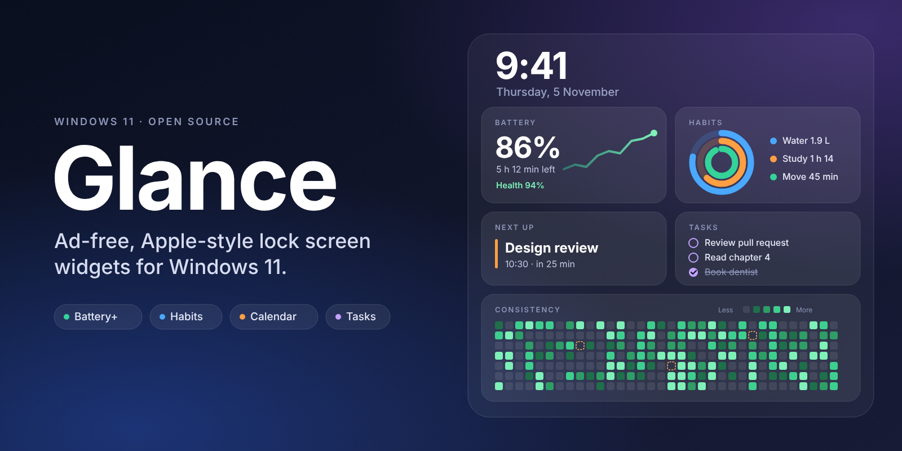

  

# Glance

**Ad-free, Apple-style lock screen widgets for Windows 11.**

Glance replaces the cluttered default widget feed with a small set of calm, useful widgets: battery stats, habit rings, your next calendar event and your tasks. It comes with a companion app that holds your data, your settings and the full-year views that a widget can't show.

> **Status: planning.** The product requirements are written ([docs/PRD.md](docs/PRD.md)); no code has been shipped yet. The first milestone is a small spike to find out how interactive widgets are on the lock screen.

## Why

Windows 11 widgets come with ads, news and suggestions. Turning them off also removes anything useful from the lock screen. Glance keeps the lock screen useful, with nothing you didn't ask for.

## What it will do

| Widget | What you see |
|---|---|
| **Battery+** | Charge and time left, plus what Windows hides: battery health, cycle count where the hardware reports it, and 24-hour and 7-day charge graphs |
| **Habit rings** | Apple Fitness-style rings for water, distraction-free study and exercise, with one-tap check-ins |
| **Consistency graph** | A GitHub-style contribution grid for any habit, with a distinct marker for cancelled days |
| **Calendar** | Your next events from Google Calendar (read-only), with a full-year browser in the companion app |
| **Tasks** | A built-in task list that works offline, with room for other task apps later |
| **System health** | CPU, RAM, disk and network with small trend lines |
| **Today card** | One combined card: next event, top task, habit rings and streak |
| **Weekly recap** | A Screen Time-style summary of your week |

Highlights:
- **Water that adapts.** A daily target you set (with an age-based starting point), which rises automatically after logged exercise, plus quiet reminders.
- **Sport sessions you can skip honestly.** Weekly recurring sessions can be marked done, cancelled or missed, and a few cancellations a month won't break your streak.
- **Study tracking you can trust.** Distraction-free time comes from the [Study with Sarang](https://github.com/sarang-cmd/study-with-sarang) app through a small local bridge.
- **Privacy modes.** Choose per widget what a passer-by can read on a locked screen: everything, redacted titles, or counts only.
- **Your layout.** Use the combined card, separate widgets, or both.

## How it works

Lock screen widgets in Windows 11 are the same widgets that live in the Widgets board, which you can pin to the lock screen. Glance is a packaged app (MSIX) that registers a widget provider through the Windows App SDK. The widgets draw Adaptive Cards, and Glance renders its rings and graphs as images.

- **Widget provider:** renders the cards from a local database.
- **Companion app (WinUI 3):** settings, privacy modes, calendar year view, habit editing.
- **Background collector:** samples battery and system data into SQLite, because a widget only runs when Windows asks it to.
- **No Microsoft Store needed:** sideload a signed package for personal use; releases will come through GitHub Releases and winget.

Stack: C#, WinUI 3, Windows App SDK, SQLite.

## Roadmap

| Milestone | Scope |
|---|---|
| M0 | Spike: one widget with one button, pinned to the lock screen |
| M1 | Battery+ and the companion app shell |
| M2 | Habits: water, exercise, contribution graph |
| M3 | Study integration and focus timer |
| M4 | Calendar and tasks |
| M5 | Today card, system health, GitHub streak, weekly recap |
| M6 | Signed release through GitHub and winget |

Details, requirements and open questions are in the [PRD](docs/PRD.md).

## Principles

Glanceable, calm, Apple-like, private by default, and honest: if a value isn't available, Glance says so instead of guessing.

## Privacy

All data stays on your device. There is no telemetry and no Glance account. Calendar access is read-only, and you bring your own Google OAuth client ID.

## Contributing

Ideas and issues are welcome, especially from anyone who has built Windows widget providers. A contributing guide will arrive with the first code.

## License

[MIT](LICENSE)
